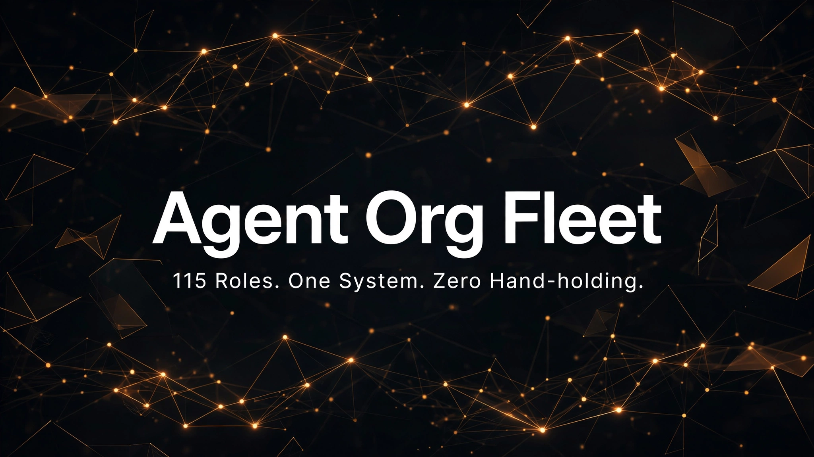
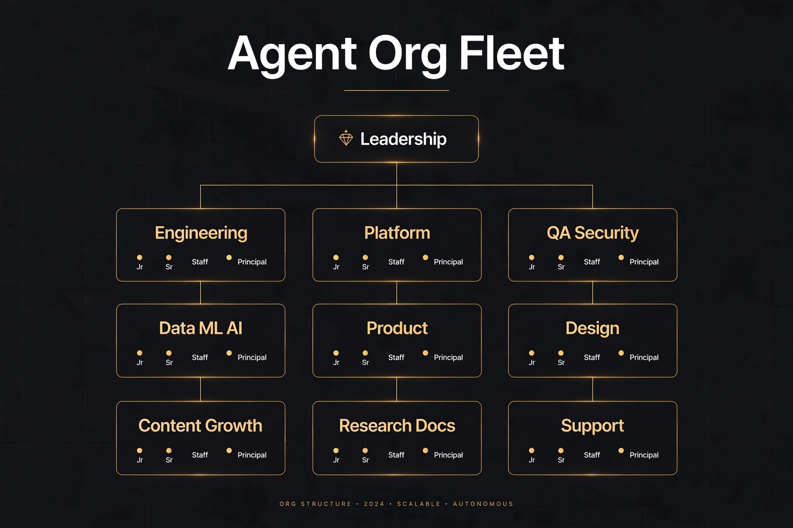

# Agent Org Fleet

  

A titled worker-role fleet for Muse operators who spawn subagents.

## What this is

115 titled worker roles in `roles/`, written like a real big-company org.
Every role has a real title you would find on a job posting: CTO-Chief Architect,
VP Engineering, Director of Platform, Principal ML Architect, Staff SRE,
Senior Frontend Engineer, QA Engineer, Associate PM, and so on. No generic
names like Worker A or Helper 2.

The ladder is NVIDIA-style, eight rungs:

- C-suite (CTO-Chief Architect, Chief of Staff)
- VP (Engineering, Product, Design, Data)
- Director and Head (Director of Engineering, Head of Security, and similar)
- Principal
- Staff
- Senior
- Engineer, Designer, Analyst, Manager (the mid level, title varies by craft)
- Associate

There are 10 departments: Executive, Engineering, Platform and Infrastructure,
QA, Security, Data and ML/AI, Product and Program, Design, Content/Marketing/Growth,
and Research/Documentation/Support.

Each role is its own short file, its own SOUL.md, 150 to 350 words. Every file
has the same shape:

1. Title, department, level
2. Reports to (a named role, never blank)
3. Pairs with the base soul at spawn time
4. Mission: what this role owns
5. Authority: what it decides alone, and what it must escalate
6. Senior-dev gate (see below)
7. Matched skills: exact file paths the worker loads before it starts
8. Verification duties
9. Report format
10. House rules and escalation target

The senior-dev gate is the same in every file, because it matters everywhere:

- Reproduce the bug first, and write down the exact failing step.
- Prove execution, not bytes. A library must load and run, a parser must
  actually parse. File size and HTTP 200 alone never count as proof.
- Surgical changes only: a minimal diff you can trace back to the request.
- If a check cannot be proven in your sandbox, say so plainly instead of
  claiming success.

House rules are also baked into every file: no GitHub push without the human
owner saying go, no credentials in chat, no real money, no irreversible
deletes, no invented facts, and reports in RESULT / VERIFIED / RISKS / REMAINING.

An operator (the main Muse agent, or you) reads `roles/ORG_INDEX.md`, picks
a role by task, and spawns a short-lived worker with that role file attached.
The worker does one scoped job, reports back, and shuts down. The operator
stays coordinator and final reviewer. See `USAGE.md` for the spawn pattern.

## Features

- 115 titled roles, no generic names, across 10 departments
- NVIDIA-style ladder with eight rungs, from C-suite agent to Associate
- Every role file follows the same 10-section template: title, department and
  level, reports-to line, mission, authority, senior-dev gate, matched skills
  as exact file paths, verification duties, report format, house rules
- `ORG_INDEX.md` holds the org tree and a task-to-role lookup table, so
  staffing a job is a lookup, not a debate
- The org-builder skill in `skill/` walks you through building your own fleet
- The two extra skills in `skills/` (`embedded-engineering`,
  `ml-data-engineering`) cover the skill paths named by the embedded, firmware,
  ML, and data roles

## Quick start

1. **Pick a role.** Open `roles/ORG_INDEX.md`, use the task-to-role lookup
   table, and choose one role for the job.
2. **Spawn with two documents.** Attach your base SOUL.md (shared rules for
   every worker) and the one role file to the worker's spawn message, then
   scope the task: outcome, constraints, deliverable, acceptance.
3. **Require the report.** Workers report in RESULT / VERIFIED / RISKS /
   REMAINING. See `USAGE.md` for the full spawn pattern and an example
   message.
4. **Install the org-builder skill (optional).** Copy the `skill/` folder to
   `~/workspace/custom-skills/org-builder/` so the skill file lands at
   `~/workspace/custom-skills/org-builder/SKILL.md`. Then "build an agent org"
   becomes a guided workflow in your own setup.

## Org Structure

The fleet runs on an eight-rung NVIDIA-style ladder, from the CTO-Chief
Architect down to Associate roles, across ten departments. Every role reports
to a named role, and the full org tree plus a task-to-role lookup table lives
in `roles/ORG_INDEX.md`.

## How Darren Labs built it

This fleet came out of real work at Darren Labs, where one operator runs
builds through ephemeral workers all day. Generic prompts kept producing
generic work, so the fleet got rebuilt around real titles and real reporting
lines. Roughly how it happened:

1. **Base soul first.** One shared base document, around 1200 words, with the
   rules every worker inherits: own the outcome, verify before claiming done,
   protect private info, pause for pushes and money and deletes. Role files
   stay short because the base carries the common weight.
2. **Define the ladder.** Eight levels, C-suite down to Associate, copied from
   how large tech companies actually title people. The ladder decides what a
   worker may decide alone and when it has to escalate.
3. **Define the departments.** Ten departments covering the work that actually
   showed up: engineering, platform, QA, security, data and ML, product,
   design, content, research and docs, support.
4. **Write the 10-section template once.** The section list above. Every role
   answers the same ten questions, so any file can be read in under a minute.
5. **Write roles in parallel batches.** Workers drafted roles department by
   department, several departments at the same time. Each file named its real
   reports-to role, picked matched skills that exist on disk as exact paths,
   and kept to 150 to 350 words.
6. **Merge and build the index.** `ORG_INDEX.md` holds the org tree (who
   reports to whom) and a task-to-role lookup table, so staffing a job is a
   lookup, not a debate.
7. **Verify with scripts, not vibes.** Counts checked (115 roles). Every file
   grepped for a reports-to line. Every matched skill path checked to exist on
   disk. Whole tree grepped for the em-dash character, count must be zero.
8. **Retire the old version.** The earlier generic roles (SENIOR_A, SENIOR_B,
   and friends) were retired out of the live folder. Keep any replaced role
   file under `roles/_retired/` with a date stamp and a note saying do not
   spawn from them. History kept, confusion gone.

## Build your own org

You do not need 115 roles. Start with the ten you actually use and grow when a
task has no good home. The steps that worked here:

1. **Define your ladder levels.** Pick 5 to 8 rungs and write down what each
   rung may decide alone. Fewer rungs is fine. Skipping the decision rights is
   not, because escalation is where agent orgs usually fall apart.
2. **List departments and functions.** Write down the kinds of work you really
   hand off: frontend, backend, QA, security review, data, docs, research.
   One department per kind of work, no more.
3. **Write the 10-section template once.** Title and level, reports to, mission,
   authority, a quality gate, matched skills, verification duties, report
   format, house rules, escalation target. Freeze the template before writing
   roles, or every file drifts into a different shape.
4. **Write role files in parallel batches.** One department per batch. Give each
   writer the template, the ladder, and the list of skill paths that exist in
   your setup. Hold the line on length: if a role file needs 1000 words, it is
   probably two roles.
5. **Build an org index.** One file with two things: the org tree showing
   reporting lines, and a task-to-role lookup table ("web UI fix goes to
   Senior Frontend Engineer"). This index is what your operator reads at spawn
   time, so keep it current when roles change.
6. **Verify with scripted checks.** Count the files. Check every file has a
   reports-to line and an escalation target. Check every skill path it names
   exists on disk. Grep for any banned characters or stale names. Run these
   checks every time you add or edit roles.
7. **Retire old versions.** When a role is replaced, move the old file out of
   the live folder into a retired folder and note it in the index. Never leave
   two live versions of the same role for an operator to pick between.

A good starter size is one Senior and one Engineer per function you use weekly,
one QA role that always verifies as a separate spawn, and one leadership role
for cross-function calls. Add Staff, Principal, and VP roles only when you
feel the gap: usually when a worker keeps escalating the same kind of call.

## Repository layout

- `roles/` - the 115 role files, plus `ORG_INDEX.md` (org tree and lookup)
  and `RESEARCH_NOTES.md` (the design research behind the fleet)
- `skill/` - the org-builder skill (`SKILL.md`). Copy this folder to
  `~/workspace/custom-skills/org-builder/` and "build an agent org" becomes a
  one-line skill in your setup
- `skills/` - the two extra skills the role files reference:
  `embedded-engineering/SKILL.md` (matched by the embedded and firmware roles)
  and `ml-data-engineering/SKILL.md` (matched by the ML and data roles). They
  ship here so every skill path named by a role file resolves to a real file
- `USAGE.md` - how a Muse operator spawns workers from this fleet
- `LICENSE` - MIT

## License

MIT. See `LICENSE`. Copyright 2026 Darren Labs / Tri Adi S. (work name Darren Lieu).

## Credits

Built by Darren Labs: the fleet came out of daily operator work with ephemeral
workers, and the org-builder skill packages that process so you can build your
own. The two extra skills in `skills/` (`embedded-engineering`,
`ml-data-engineering`) are included so the skill paths named by the embedded,
firmware, ML, and data role files resolve to real files.
